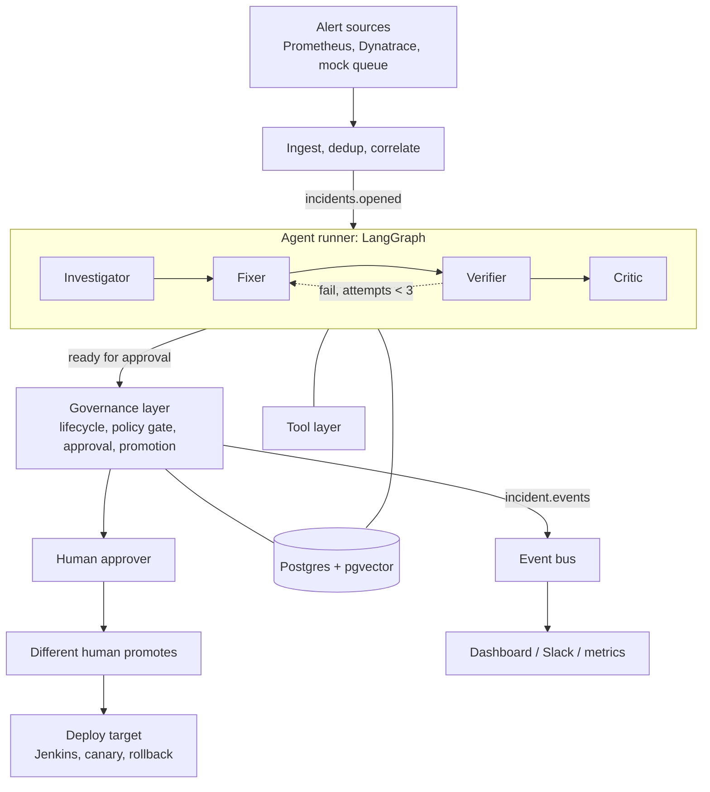

# IncidentFlow-AI: Target Architecture

Status: design. Phase 0 (safety and test foundation) and Phase 1 (audit log, event bus, lifecycle guard, alert correlation) are implemented; the agent workflow (Phases 2 to 7) is not. The current code is described in `README.md` and `next/README.md`.

Implementation notes since this was written:
- `awaiting_approval` was dropped as a state. A change is awaiting approval when it is `ready_for_prod` with status `pending_approval`; the reviewing step moves to `ready_for_prod`.
- The allowed transitions live in `src/app/services/lifecycle.py` and are enforced for every write.
- `EventBus` is pull-based with per-group offset commits (`poll`/`commit`), implemented by `InProcessBus` and `PostgresBus` (transactional outbox). Nothing consumes the events yet.

## 1. Scope and decisions

| Decision | Choice |
|---|---|
| Autonomy | **L1 only.** Agents investigate, fix and verify up to dev. A human approves and a different human promotes to prod. No auto-approve, no auto-promote. |
| Agents | Four LLM agents: Investigator, Fixer, Verifier, Critic. |
| Agent orchestration | **LangGraph** for the agent loop, with a Postgres checkpointer. |
| Governance | Plain Python (not LangGraph): lifecycle states, policy gate, approval, promotion, audit log. |
| Event backbone | An `EventBus` interface. Designed for Kafka; implemented now with an in-process/Postgres bus. |
| System of record | Postgres (+ pgvector for incident memory). JSON files remain as the zero-setup backend. |
| Fidelity | The architecture is real-environment capable. The implementation targets a local demo: mocks and the Docker APM stack behind the same interfaces. |

Non-goals for now: fully automatic prod promotion, multi-tenancy, Kubernetes operators, a UI rewrite.

## 2. Principles

1. **LLMs reason; code decides.** Agents propose and assess. State transitions, policy and anything touching production are deterministic code.
2. **Agents act only through tools.** Tools are read-only by default. The only write path is the repo worktree, scoped to allowed paths.
3. **Independent verification.** The Verifier never trusts the Fixer's claims; it has its own prompt, tools and model setting.
4. **Evidence over assertion.** Every conclusion cites the metrics, logs or past incidents behind it. Confidence is computed from signal agreement, not the LLM's self-rating.
5. **The graph cannot bypass governance.** The graph may request "awaiting approval"; only the governance layer moves a change toward prod.
6. **Everything is auditable.** Every transition and tool call writes an append-only audit event with a real actor.
7. **Same interface, many backends.** Every external system has a mock, a local, and a real implementation.

## 3. System overview



Two layers with a hard boundary:

- **Agent runner** (new, LangGraph): produces a *proposal package* (hypotheses, diff, verification evidence, review notes). It never changes a change's approval or deployment state.
- **Governance layer** (existing `ChangeControlStore`, hardened): owns the lifecycle and is the only code that can move a change to approved, promoting or promoted.

## 4. Components

### 4.1 Ingest and correlation
- `AlertSource` adapters (existing: mock queue, HTTP bridge, Dynatrace) normalize to `APMEvent`.
- Dedup by `source_alert_id` (existing `AlertDedupStore`), moved to a DB table with a unique constraint.
- Correlation groups alerts for the same service within a window into one incident (new). Emits `incidents.opened`.

### 4.2 Event bus
```python
class EventBus(Protocol):
    def publish(self, topic: str, key: str, event: dict) -> None: ...
    def subscribe(self, topic: str, group: str) -> Iterator[Event]: ...
```
Implementations: `InProcessBus` (tests, demo), `PostgresBus` (outbox table, durable), `KafkaBus` (designed, optional). Delivery is at-least-once, so all consumers are idempotent (see 8.4).

Topics: `alerts.raw`, `incidents.opened`, `incident.events` (lifecycle and audit stream). Keyed by service so per-service ordering holds.

### 4.3 Agent runner (LangGraph)
One graph run per incident, `thread_id = incident_id`, checkpointed to Postgres after every node. Details in section 6.

### 4.4 Agents

| Agent | Input | Tools | Output | Limits |
|---|---|---|---|---|
| Investigator | Incident, alerts | `MetricsTool`, `LogsTool`, `DeployHistoryTool`, `IncidentMemory` | 2 to 3 ranked `Hypothesis` objects, each with supporting and contradicting evidence refs | Max tool calls and token budget per run |
| Fixer | Top hypothesis, repo | `RepoSandbox` (read, grep, edit in worktree) | `FixProposal`: diff, rationale, files touched | Allowed paths, max lines, no secrets or CI files |
| Verifier | `FixProposal` | `RepoSandbox` (run tests), `DeployTarget` (dev), `MetricsTool` | `VerificationReport`: tests, before/after metric, load replay, pass/fail with reasons | Never reads the Fixer's rationale as evidence |
| Critic | Everything above | read-only | `Review`: risk, blast radius, scope-creep flags, evidence-supports-claim check | Can return "send back" or "flag" |

Each agent is a plain tool-calling loop over the `LLMClient` interface, with a per-agent model setting. Outputs are validated against Pydantic schemas; an invalid output counts as a failed attempt.

### 4.5 Tool layer
```python
class MetricsTool(Protocol):   def query(self, service, metric, window) -> Series: ...
class LogsTool(Protocol):      def search(self, service, query, window) -> list[LogLine]: ...
class DeployHistoryTool(Protocol): def recent(self, service, window) -> list[Deploy]: ...
class IncidentMemory(Protocol):    def search(self, text, service, k) -> list[ScoredIncident]: ...
class RepoSandbox(Protocol):   # git worktree
    def read(self, path); def grep(self, pattern); def edit(self, path, content); def run_tests(self) -> TestResult
class DeployTarget(Protocol):  def deploy_dev(self, ref) -> DeployResult; def canary(self, ref, pct); def rollback(self, ref)
class JenkinsClient(Protocol): def trigger_dev_validation(...); def trigger_prod_deploy(...); def get_build_status(ref) -> BuildStatus
```
Every tool call is logged (inputs, output hash, duration) to the audit stream.

### 4.6 Governance layer
Owns the incident/change lifecycle (section 5), the policy gate, approval and promotion. Rules:

- Dev validation must be `SUCCESS`. A queued or running prod deploy is `promoting`, never `promoted_to_prod`.
- State is checked and reserved **before** any external call (reserve, then call Jenkins, then finalize).
- The approver and the promoter must be different actors (enforced when auth is enabled). The dev-run executor may be the approver.
- Policy inputs: evidence-derived confidence, zero integration warnings, verification passed, issue type known, Critic did not block.
- A failed Jira/Jenkins call never becomes a fake success (see 8.3).

### 4.7 Storage
- `incidents`, `changes` (versioned rows, optimistic locking), `audit_events` (append-only), `incident_embeddings` (pgvector), `alert_dedup`, `outbox`, plus LangGraph checkpoint tables.
- Embeddings are created from summary + root cause + resolution when an incident resolves, so memory only contains outcomes that were reviewed.

## 5. Lifecycle

```
awaiting_dev_execution -> investigating -> hypothesis_ready -> fixing -> verifying -> reviewing
         -> ready_for_prod (awaiting human approval) -> promoting -> promoted_to_prod -> monitoring -> resolved
```
(`awaiting_dev_execution` is the entry state today, standing in for `received`. Approval is the separate `status` field: `pending_approval` -> `approved`/`rejected`.)
Exits: `escalated` (any agent gives up or confidence too low), `closed_rejected` (human says no), `rolled_back` (canary failed), `prod_promotion_failed`.

| From | To | Triggered by | Guard |
|---|---|---|---|
| received | investigating | graph start | |
| investigating | hypothesis_ready / escalated | Investigator | evidence confidence >= threshold else escalate |
| fixing | verifying | Fixer | diff within allowed paths and line limit |
| verifying | reviewing / fixing / escalated | Verifier | pass; fail and attempts < 3; fail and attempts = 3 |
| reviewing | ready_for_prod / fixing / escalated | Critic | `ready_for_prod` + status `pending_approval` = awaiting approval |
| ready_for_prod (pending) | ready_for_prod (approved) / blocked_by_policy / closed_rejected | human approver | role approver; policy gate |
| ready_for_prod (approved) | promoting | human release operator | actor != approver; policy gate; reservation succeeds |
| promoting | monitoring / promotion_failed | Jenkins `SUCCESS` / failure | confirmed status only |
| monitoring | resolved / rolled_back | canary window | metric within bound else rollback |

The `deployment_state` Literal in `schemas.py` already includes `investigating`, `hypothesis_ready`, `fixing`, `verifying`, `reviewing`, `escalated`, `promoting`, `monitoring`, `resolved`, `rolled_back`.

## 6. Agent graph

```python
g = StateGraph(IncidentState)
g.add_node("investigate", investigator)
g.add_node("fix", fixer)
g.add_node("verify", verifier)
g.add_node("review", critic)
g.add_node("package", build_proposal_package)   # PR + Jira + evidence bundle
g.add_node("escalate", escalate_to_human)

g.set_entry_point("investigate")
g.add_conditional_edges("investigate", route_confidence,
    {"fix": "fix", "escalate": "escalate"})
g.add_edge("fix", "verify")
g.add_conditional_edges("verify", route_verification,
    {"pass": "review", "retry": "fix", "give_up": "escalate"})
g.add_conditional_edges("review", route_review,
    {"ok": "package", "send_back": "fix", "block": "escalate"})
g.add_edge("package", END)    # hands off to governance: ready_for_prod, pending approval
```

`IncidentState` carries: incident, evidence refs, hypotheses, fix proposal, verification reports (all attempts), review, attempt counter, token/tool budgets, warnings. Retries feed the Verifier's failure evidence back into the Fixer's next prompt.

The graph ends at `package`. Approval and promotion happen outside the graph, in governance code, via the API.

## 7. End-to-end flow

1. Alert arrives, is deduped and correlated; `incidents.opened` is published.
2. Runner starts the graph. **Investigate:** retrieve similar incidents, query metrics/logs/deploys, rank hypotheses, compute evidence-based confidence. Low confidence escalates with the evidence attached.
3. **Fix:** worktree edit, scoped and size-limited.
4. **Verify:** run tests, deploy to dev, compare incident metric before/after, replay load. Failures loop back (max 3).
5. **Review:** Critic checks diff, blast radius, and that evidence supports the claim.
6. **Package:** draft PR, Jira ticket, evidence bundle, timeline. State becomes `ready_for_prod` with status `pending_approval`.
7. A human approves (governance layer re-runs the policy gate). A different human promotes.
8. Governance reserves the promotion, triggers Jenkins, polls until `SUCCESS`, then monitors the canary window; failure rolls back and reopens the incident.
9. On resolution, outcome + evidence are embedded into incident memory and a postmortem draft is generated.

## 8. Cross-cutting concerns

### 8.1 Security
- LLM input hygiene: alert/log text is untrusted; placed in a data field, never in the instruction portion of a prompt.
- Fixer limits: allowed-path list, max lines, deny list (secrets, CI config, deploy scripts).
- Auth: API key and JWT remain; auth-disabled mode returns a non-privileged principal and is refused outside `ENV=dev`.

### 8.2 Budgets
Per-incident caps on tokens, tool calls and wall-clock time per agent. Exceeding a cap escalates; it never loops.

### 8.3 Failure handling
- Jira failure: `jira_key=None`, `jira_sync_status=pending_retry`, retried by a background job. No fake key.
- Jenkins failure: `jenkins_status=UNKNOWN`; the policy gate blocks it.
- `*_MODE=real` that cannot start fails startup unless `ALLOW_MOCK_FALLBACK=true` (demo only).
- LLM failure: the node retries with backoff, then escalates.

### 8.4 Idempotency and concurrency
- Dedup keys on alerts, a unique key per promotion attempt, and `INSERT ... ON CONFLICT` on event handling.
- `changes` rows carry a `version`; updates are `UPDATE ... WHERE version = %s`, with retry on conflict.
- JSON backend writes via temp file + rename.

### 8.5 Observability
- OpenTelemetry spans per node and tool call; metrics for triage time, time to verified fix, escalation rate, human override rate, tokens and cost per incident.

## 9. Real versus implemented-now

| Capability | Real-environment design | Implemented first |
|---|---|---|
| Alert source | Alertmanager, Dynatrace, others via `AlertSource` | Mock queue and the local Prometheus stack |
| Event bus | Kafka | `InProcessBus` / `PostgresBus` |
| Logs | Loki, Elasticsearch | Local Loki in Docker, or fixture log files |
| Jenkins | Real with status polling | Mock that progresses RUNNING then SUCCESS or FAILURE |
| Deploy target | Kubernetes with canary | Docker/compose target or mock |
| Incident memory | pgvector | pgvector in compose, with a stub embedder in tests |
| LLM | Any OpenAI-compatible or Anthropic | Same; mock LLM in tests |
| Auth | OIDC/SSO | API key + JWT |

## 10. Mapping from current code

| Current | Becomes |
|---|---|
| `triage_agent.py`, `llm_client.py` | Investigator (adds tools and memory) |
| `code_fix_agent.py` and its simulator | Fixer; the simulator is replaced by the Verifier |
| `dev_fix_executor.py` | Verifier's dev-deploy tool |
| `pipeline.py` | Thin ingest + graph start; no mock fallbacks |
| `change_control.py` | Governance layer, with the promoting state, reservation, versioned writes |
| `scheduler.py` | Alert poller publishing to the bus; auto-remediation modes removed |
| `knowledge_base.py` | `IncidentMemory` (pgvector) |
| `pr_preparer.py` | `RepoSandbox` + the `package` node |
| `integration_factory.py` | Builds tools and adapters; strict about real mode |

New package layout (proposed):
```
src/app/agents/        investigator.py fixer.py verifier.py critic.py prompts/
src/app/graph/         state.py graph.py routing.py
src/app/tools/         metrics.py logs.py deploys.py memory.py sandbox.py
src/app/governance/    lifecycle.py policy.py approvals.py promotion.py
src/app/events/        bus.py inprocess.py postgres.py kafka.py
```

## 11. Build phases

0. **Safety and test foundation:** isolated test fixtures, CI, promote reserve-then-call, strict policy (`SUCCESS`), Jenkins status polling, remove mock fallbacks and auto-remediation modes, versioned Postgres writes.
1. **Event bus and lifecycle:** `EventBus`, audit events, new states, correlation.
2. **Tool layer:** metrics/logs/deploys/memory/sandbox interfaces with mock and local implementations.
3. **Investigator:** retrieval + tools + evidence-based confidence; replay/eval harness to measure it.
4. **Verifier:** real test and dev-deploy checks, before/after metrics.
5. **Fixer and Critic:** tool-using Fixer, then Critic; wire the full LangGraph run with checkpointing.
6. **Dashboard:** timeline, evidence view, approval and promotion screens, live status.
7. **Hardening:** shadow mode, cost/loop budgets, postmortems, optional Kafka adapter.

## 12. Open questions

- Which model per agent (a different model for the Verifier and Critic is recommended).
- Which fault types to add to `faulty_project/` for the demo (memory leak, bad deploy, dependency timeout).
- Whether the shadow-mode comparison feeds the evaluation set automatically.
