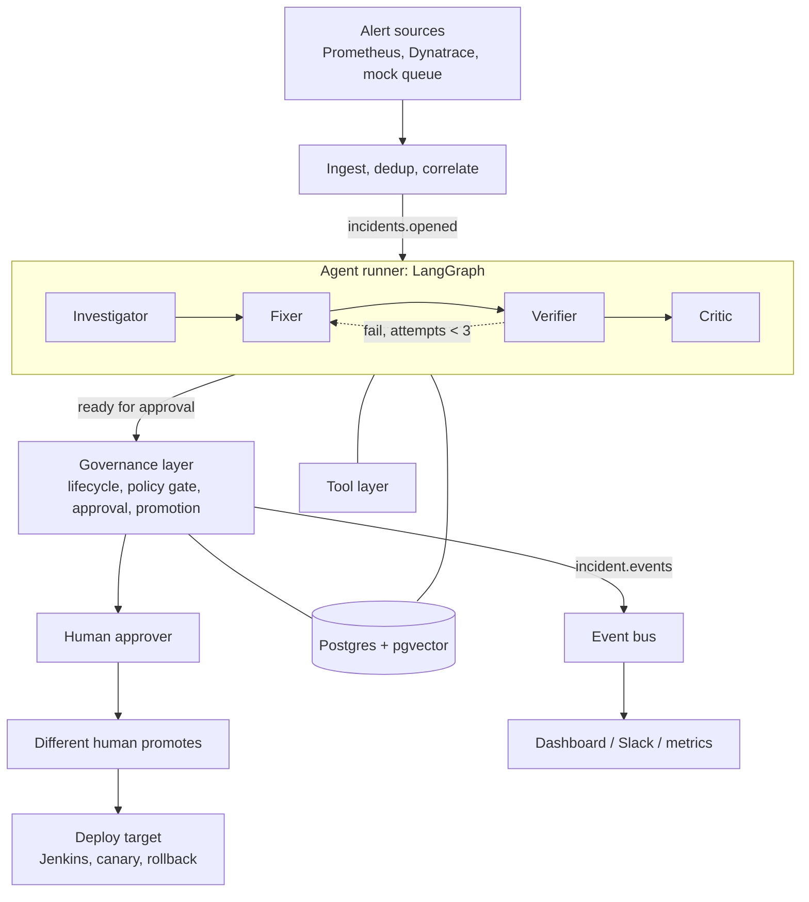

# IncidentFlow-AI: Target Architecture

Status: design. Phase 0 (safety and test foundation), Phase 1 (audit log, event bus, lifecycle guard, alert correlation) and Phase 2 (tool layer) and Phase 3 (Investigator and replay harness) and Phase 4 (Verifier) are implemented, and Phase 5 (Fixer, Critic, the LangGraph run and its live wiring) is implemented. Phases 6 and 7 (richer dashboard, hardening, shadow mode, Kafka, learning from outcomes) are not. The current code is described in `README.md` and `next/README.md`.

Implementation notes since this was written:
- `awaiting_approval` was dropped as a state. A change is awaiting approval when it is `ready_for_prod` with status `pending_approval`; the reviewing step moves to `ready_for_prod`.
- The allowed transitions live in `src/app/services/lifecycle.py` and are enforced for every write.
- `EventBus` is pull-based with per-group offset commits (`poll`/`commit`), implemented by `InProcessBus` and `PostgresBus` (transactional outbox). Nothing consumes the events yet.

## 1. Scope and decisions

| Decision | Choice |
|---|---|
| Autonomy | **L1 only.** Agents investigate, fix and verify up to dev. A human approves and a different human promotes to prod. No auto-approve, no auto-promote. |
| Agents | Four LLM agents: Investigator, Fixer, Verifier, Critic. |
| Agent orchestration | **LangGraph** for the agent loop, with a Postgres checkpointer. |
| Governance | Plain Python (not LangGraph): lifecycle states, policy gate, approval, promotion, audit log. |
| Event backbone | An `EventBus` interface. Designed for Kafka; implemented now with an in-process/Postgres bus. |
| System of record | Postgres (+ pgvector for incident memory). JSON files remain as the zero-setup backend. |
| Fidelity | The architecture is real-environment capable. The implementation targets a local demo: mocks and the Docker APM stack behind the same interfaces. |

Non-goals for now: fully automatic prod promotion, multi-tenancy, Kubernetes operators, a UI rewrite.

## 2. Principles

1. **LLMs reason; code decides.** Agents propose and assess. State transitions, policy and anything touching production are deterministic code.
2. **Agents act only through tools.** Tools are read-only by default. The only write path is the repo worktree, scoped to allowed paths.
3. **Independent verification.** The Verifier never trusts the Fixer's claims; it has its own prompt, tools and model setting.
4. **Evidence over assertion.** Every conclusion cites the metrics, logs or past incidents behind it. Confidence is computed from signal agreement, not the LLM's self-rating.
5. **The graph cannot bypass governance.** The graph may request "awaiting approval"; only the governance layer moves a change toward prod.
6. **Everything is auditable.** Every transition and tool call writes an append-only audit event with a real actor.
7. **Same interface, many backends.** Every external system has a mock, a local, and a real implementation.

## 3. System overview



Two layers with a hard boundary:

- **Agent runner** (new, LangGraph): produces a *proposal package* (hypotheses, diff, verification evidence, review notes). It never changes a change's approval or deployment state.
- **Governance layer** (existing `ChangeControlStore`, hardened): owns the lifecycle and is the only code that can move a change to approved, promoting or promoted.

## 4. Components

### 4.1 Ingest and correlation
- `AlertSource` adapters (existing: mock queue, HTTP bridge, Dynatrace) normalize to `APMEvent`.
- Dedup by `source_alert_id` (existing `AlertDedupStore`), moved to a DB table with a unique constraint.
- Correlation groups alerts for the same service within a window into one incident (new). Emits `incidents.opened`.

### 4.2 Event bus
```python
class EventBus(Protocol):
    def publish(self, topic: str, key: str, event: dict) -> None: ...
    def subscribe(self, topic: str, group: str) -> Iterator[Event]: ...
```
Implementations: `InProcessBus` (tests, demo), `PostgresBus` (outbox table, durable), `KafkaBus` (designed, optional). Delivery is at-least-once, so all consumers are idempotent (see 8.4).

Topics: `alerts.raw`, `incidents.opened`, `incident.events` (lifecycle and audit stream). Keyed by service so per-service ordering holds.

### 4.3 Agent runner (LangGraph)
One graph run per incident, `thread_id = incident_id`, checkpointed to Postgres after every node. Details in section 6.

### 4.4 Agents

| Agent | Input | Tools | Output | Limits |
|---|---|---|---|---|
| Investigator | Incident, alerts | `MetricsTool`, `LogsTool`, `DeployHistoryTool`, `IncidentMemory` | 2 to 3 ranked `Hypothesis` objects, each with supporting and contradicting evidence refs | Max tool calls and token budget per run |
| Fixer | Top hypothesis, repo | `RepoSandbox` (read, grep, edit in worktree) | `FixProposal`: diff, rationale, files touched | Allowed paths, max lines, no secrets or CI files |
| Verifier | `FixProposal` | `RepoSandbox` (run tests), `DeployTarget` (dev), `MetricsTool` | `VerificationReport`: tests, before/after metric, load replay, pass/fail with reasons | Never reads the Fixer's rationale as evidence |
| Critic | Everything above | read-only | `Review`: risk, blast radius, scope-creep flags, evidence-supports-claim check | Can return "send back" or "flag" |

Each agent is a plain tool-calling loop over the `LLMClient` interface, with a per-agent model setting. Outputs are validated against Pydantic schemas; an invalid output counts as a failed attempt.

**Investigator, as implemented (Phase 3, `src/app/agents/`):**
- **Evidence first.** A fixed plan (`collector.py`) always runs through the audited tool proxies and produces numbered `Evidence` items (`E1`...). Tags are assigned by code from the data (`evidence.py`): a metric is anomalous by arithmetic on its points, a deploy "preceded the onset" by timestamps (within 30 minutes), a log shows a "timeout" by pattern match. Another service's evidence is kept for context but tagged `foreign` and never scored.
- **Confidence is computed, not asked for** (`scoring.py`). Each issue type has a fixed set of expected signals (weights sum to 1) and a few contradicting ones; confidence is the weight of the signals observed minus the contradictions. It reads only evidence tags, so citing evidence or claiming certainty cannot raise it, and a hypothesis with no *specific* signal (e.g. only "no recent deploy") scores 0. `unknown` rises as the others fall, capped at 0.5.
- **Model optional** (`INVESTIGATOR_MODE=llm`). It may make up to `INVESTIGATION_MAX_LLM_STEPS` extra evidence requests (logs, metrics, deploys, memory only, and the arguments are parsed into typed requests, never passed through) and writes the root-cause wording citing evidence ids. Invalid output, unknown evidence ids, a model error or a spent budget fall back to the evidence-based answer with a warning; a first choice that contradicts the evidence is overruled and flagged.
- **Decision.** Escalate when the top hypothesis is `unknown`, below `INVESTIGATION_MIN_CONFIDENCE` (0.60), or within `INVESTIGATION_MIN_MARGIN` (0.10) of the runner-up; otherwise proceed.
- **Untrusted text.** Log lines and deploy descriptions are cleaned and length-capped, sent to the model only as quoted data under a system prompt that says to ignore instructions inside them, and cannot affect confidence.
- **Replay harness** (`src/app/replay.py`, `scripts/replay_investigations.py`): runs the seven built-in scenarios and reports accuracy against the old keyword classifier, `harmful` outcomes (proceeding with a wrong answer or where only a human could help), automation rate, unneeded escalations and root-cause keyword coverage. The scenarios and rules were written together, so this is a regression check, not an accuracy estimate for real incidents.
- **Not yet done:** the Investigator is built at startup but not called from the live incident flow (Phase 5 wires the graph), and the LLM path has only been exercised against a scripted model.

**Verifier, as implemented (Phase 4, `src/app/agents/verifier.py`):**
- **Code-first, no model.** Its purpose is independence, so it depends neither on the Fixer nor on a model. (A model-assisted adversarial probe could be added later; it would only ever be able to add concerns, never turn a failed check into a pass.) It still acts only through its own least-privilege tool proxies, and every call is audited under `agent:verifier`.
- **It checks reality, not the claim.** `sandbox.diff()` is now `git diff HEAD` (new files included) in a git worktree, so it also sees edits that bypassed the sandbox. Protected files appear by path with their content replaced by a marker, so a secret never reaches a report. The input `FixProposal` carries `claimed_files` and a `rationale`; the rationale is ignored, and a test proves changing it cannot change the report.
- **Ordered, fail-fast checks:** `diff_present`, `claimed_files_match`, `scope` (allow-list, protected files, size cap), `syntax` (JSON, Python, YAML when a parser is installed), `tests`, `dev_deploy`, `alert_metric_recovered` (dev median below the alert threshold and improved by at least `VERIFIER_MIN_IMPROVEMENT` versus the incident level seen in production metrics), `no_side_effects` (no other metric elevated 1.5x over its own baseline). Each stage only runs if every required check before it passed, so a change that fails scope, syntax or tests is never deployed. Skipped checks are still listed.
- **Verdict:** `failed` if any required check failed; `inconclusive` if one could not be evaluated (no data, deploy still running, tool budget spent); `passed` only when all passed. `feedback_for_fixer` lists the failing checks for the retry loop.
- **Dev environment.** `dev_metrics` is a second metrics tool (the dev environment after deploy), alongside `metrics` (production, for the "before"). In mock mode `MockDevEnvironment` is both the deploy target and its metrics: a deployed branch changes the numbers according to an effect declared for it (`resolves`, `no_effect`, `partial`, `regresses_other`, `deploy_fails`), which the Verifier is never told. A real Jenkins deploy target must be paired with real dev Prometheus; startup refuses the mixed setup.
- **Scorecard** (`scripts/replay_verifications.py`): 13 cases built on real temporary git repos. It reports false passes (the dangerous failure), false fails, changes deployed that an earlier check should have stopped, and secret leaks. The cases were written by the same author as the checks, so this is a regression check, not an estimate of real-world accuracy.
- **Known limits:** a pre-existing failing test suite fails every fix (the Verifier cannot revert to compare); the alert-threshold comparison assumes an alert that fires when a metric rises; real dev verification (replayed load against a dev cluster) is not implemented.

**Fixer and Critic, as implemented (Phase 5, part 1):**
- **Fixer** (`agents/fixer.py`). A model-driven loop over the Fixer's own tools only (`sandbox.list_files/read/grep/edit/diff`, `memory.search`), bounded by `FIXER_MAX_STEPS`. It receives the diagnosis, the evidence (cited items first, capped at 20), the editable paths and size cap, and on a retry the Verifier's `feedback_for_fixer`. Files, evidence and feedback are quoted as untrusted data under a system prompt that says so. It returns `proposed`, `no_fix` or `failed`: no model, a model that declines, a model that claims a fix but changed nothing, a malformed reply, or a spent tool budget are all reported, never turned into a change. `claimed_files` comes from the worktree diff, never from the model. There is deliberately no template fallback.
- **Retries start clean.** `FileSandbox.reset()` (`git reset --hard` plus `git clean`) is for the orchestrator only (it is in no agent's permissions) and is refused unless the sandbox is marked `disposable`, which only the worktree provider sets, so it cannot wipe someone's real working copy.
- **Critic** (`agents/critic.py`), code-first like the Verifier. Concerns have a severity: `blocking` (verification did not pass, or the investigation had no confident diagnosis) blocks; `major` (a change that no evidence implicates, or extra files alongside the right one) sends the fix back with feedback; `minor`/`info` (thin recovery, moderate confidence, cannot relate the change to the evidence, medium/high risk) travel with the fix to the human. Risk is `high` for security/payment/schema-looking paths, more than 5 files or 150 lines, `medium` for source code or more than 2 files or 50 lines, otherwise `low`. The Fixer's rationale is never an input.
- **Optional model for the Critic** (`CRITIC_MODE=llm`) can only add `minor`/`major` concerns (a `blocking` severity from a model is rejected as invalid), so it can make a review stricter but never approve something the rules did not, and a model error is a warning, not a change of outcome.
- **Known limits:** the Critic relates a change to evidence by file name found in deploy summaries and quoted logs, which only works when the evidence names a file; files ignored by `.gitignore` do not appear in the sandbox diff; the Fixer and the model-assisted Critic have only been exercised against a scripted model.

**The agent run, as implemented (Phase 5, part 2: `agents/graph.py`, `agents/runner.py`):**
- **Graph.** `investigate -> fix -> verify -> review -> package`, with a `retry` edge back to `fix` and an escalation exit from every stage. Routing is a `next_step` field each node sets; any unexpected exception in a node routes to a `crash` node that escalates, so a change is never left in a working state.
- **Governance outside the graph.** Nodes never write a state directly. They call `ChangeControlStore.begin_agent_run`, `record_agent_step` (only the states `hypothesis_ready`, `fixing`, `verifying`, `reviewing`, `escalated`) and `finish_agent_run`, each validated by the lifecycle table and audited under the acting agent. `finish_agent_run` is the only route to `ready_for_prod`: it records the Verifier's evidence as the change's dev-execution evidence and re-runs the policy gate; the change stays `pending_approval`. Approval and promotion are not reachable from the graph.
- **Retries.** A failed verification or a Critic `send_back` retries up to `AGENT_MAX_FIX_ATTEMPTS` (default 3) on a freshly reset worktree with the failing checks as feedback. An `inconclusive` verification, a Critic `block`, a Fixer that proposes nothing, or an investigation that does not proceed escalates immediately: more attempts cannot create missing data.
- **Branch and worktree.** Runs use `agent-fix/<change>-<service>`, not the `agent/...` branch the prepare-pr flow uses for the same change, because recreating that branch with `-B` would discard commits the PR flow made on it. `GitWorktreeProvider.open` clears a stale worktree for the same branch first, so a change can be run again. A worktree is only created when the Fixer has a model to use it.
- **Triggering.** `AGENT_RUN_MODE` is `off` (default), `manual` (endpoint and dashboard button) or `auto` (a hook after `pipeline.process_event`, which also covers the scheduler; a failure to start a run never breaks intake). `begin_agent_run` is the reservation, so duplicates and concurrent starts are refused.
- **The alert is persisted on the change** so a run can reconstruct its context later. Changes created before this have no alert and cannot be investigated.
- **Deviation from the design above: in-flight state is not durable.** The graph uses LangGraph's in-memory checkpointer rather than a Postgres one. Results (reports, attempts, escalation reason) are saved on the change record in either storage backend, and `recover_interrupted_runs()` at startup escalates any run left `running`, so a restart is visible and recoverable, but a run cannot be resumed mid-flight.
- **Not done:** the run does not open the draft PR or the Jira ticket (`package` records the evidence bundle on the change; the existing `prepare-pr` flow is still a separate human step and does not use the agent's branch); the Fixer, the model-assisted Critic and the Investigator's model path have not run against a real model, only a scripted one and a local stand-in for the API.
- **Defects found by running it for real** (a temp repo and mocks had hidden all three): re-running a change failed on git ("cannot force update the branch used by worktree"); the two flows would have shared a branch name; and the Investigator found the incident under investigation in incident memory (the pipeline files every new incident, with a placeholder resolution, before the agents run) and counted it as corroborating evidence, inflating confidence. Memory now ignores placeholder-resolution records and the incident under investigation, because past incidents' labels came from the keyword classifier and say nothing about the cause.

### 4.5 Tool layer
```python
class MetricsTool(Protocol):   def query(self, service, metric, window) -> Series: ...
class LogsTool(Protocol):      def search(self, service, query, window) -> list[LogLine]: ...
class DeployHistoryTool(Protocol): def recent(self, service, window) -> list[Deploy]: ...
class IncidentMemory(Protocol):    def search(self, text, service, k) -> list[ScoredIncident]: ...
class RepoSandbox(Protocol):   # git worktree
    def read(self, path); def grep(self, pattern); def edit(self, path, content); def run_tests(self) -> TestResult
class DeployTarget(Protocol):  def deploy_dev(self, ref) -> DeployResult; def canary(self, ref, pct); def rollback(self, ref)
class JenkinsClient(Protocol): def trigger_dev_validation(...); def trigger_prod_deploy(...); def get_build_status(ref) -> BuildStatus
```
Every tool call is logged (inputs, output hash, duration) to the audit stream.

**As implemented (Phase 2, `src/app/tools/`):**
- Interfaces: `MetricsTool` (`available_metrics`, `query`), `LogsTool` (`search`), `DeployHistoryTool` (`recent`), `IncidentMemory` (`search`), `RepoSandbox` (`list_files`, `read`, `grep`, `edit`, `diff`, `run_tests`), `DeployTarget` (`deploy_dev`, `get_status`, `canary`, `rollback`). Calls take a `TimeWindow`, not a free-form duration.
- Backends: metrics `mock` | `prometheus` (fixed service/metric -> PromQL catalog; agents never supply PromQL); logs `mock` | `file` (JSONL); deploy history `mock` | `changes` (derived from promoted change records); memory `lexical` (TF-IDF with a same-service boost; pgvector replaces it behind the same interface); deploy target `mock` | `jenkins` (dev only).
- Mock backends serve three deterministic incident scenarios (`tools/scenarios.py`) with known answers, which Phase 3's replay/eval harness will score against.
- **Least privilege.** Agents never hold a raw tool. `Toolkit.for_agent(agent, ...)` returns proxies exposing only the methods in `AGENT_PERMISSIONS` (only the Fixer can `edit`; only the Verifier can `run_tests` or `deploy_dev`; nobody can `canary` or `rollback`, which belong to governance). Each call counts against a per-run budget and writes an audit entry under `agent:<name>`; denied attempts are audited too.
- **Sandbox guardrails.** Paths are confined to the worktree (absolute paths, `..`, symlinks and Windows junctions are refused, including when listing and grepping); secrets and CI/deploy files cannot be read or edited; edits are limited to an allow-list and a line cap; tests run with a scrubbed environment so repo code never sees platform API keys.

### 4.6 Governance layer
Owns the incident/change lifecycle (section 5), the policy gate, approval and promotion. Rules:

- Dev validation must be `SUCCESS`. A queued or running prod deploy is `promoting`, never `promoted_to_prod`.
- State is checked and reserved **before** any external call (reserve, then call Jenkins, then finalize).
- The approver and the promoter must be different actors (enforced when auth is enabled). The dev-run executor may be the approver.
- Policy inputs: evidence-derived confidence, zero integration warnings, verification passed, issue type known, Critic did not block.
- A failed Jira/Jenkins call never becomes a fake success (see 8.3).

### 4.7 Storage
- `incidents`, `changes` (versioned rows, optimistic locking), `audit_events` (append-only), `incident_embeddings` (pgvector), `alert_dedup`, `outbox`, plus LangGraph checkpoint tables.
- Embeddings are created from summary + root cause + resolution when an incident resolves, so memory only contains outcomes that were reviewed.

## 5. Lifecycle

```
awaiting_dev_execution -> investigating -> hypothesis_ready -> fixing -> verifying -> reviewing
         -> ready_for_prod (awaiting human approval) -> promoting -> promoted_to_prod -> monitoring -> resolved
```
(`awaiting_dev_execution` is the entry state today, standing in for `received`. Approval is the separate `status` field: `pending_approval` -> `approved`/`rejected`.)
Exits: `escalated` (any agent gives up or confidence too low), `closed_rejected` (human says no), `rolled_back` (canary failed), `prod_promotion_failed`.

| From | To | Triggered by | Guard |
|---|---|---|---|
| received | investigating | graph start | |
| investigating | hypothesis_ready / escalated | Investigator | evidence confidence >= threshold else escalate |
| fixing | verifying | Fixer | diff within allowed paths and line limit |
| verifying | reviewing / fixing / escalated | Verifier | pass; fail and attempts < 3; fail and attempts = 3 |
| reviewing | ready_for_prod / fixing / escalated | Critic | `ready_for_prod` + status `pending_approval` = awaiting approval |
| ready_for_prod (pending) | ready_for_prod (approved) / blocked_by_policy / closed_rejected | human approver | role approver; policy gate |
| ready_for_prod (approved) | promoting | human release operator | actor != approver; policy gate; reservation succeeds |
| promoting | monitoring / promotion_failed | Jenkins `SUCCESS` / failure | confirmed status only |
| monitoring | resolved / rolled_back | canary window | metric within bound else rollback |

The `deployment_state` Literal in `schemas.py` already includes `investigating`, `hypothesis_ready`, `fixing`, `verifying`, `reviewing`, `escalated`, `promoting`, `monitoring`, `resolved`, `rolled_back`.

## 6. Agent graph

```python
g = StateGraph(IncidentState)
g.add_node("investigate", investigator)
g.add_node("fix", fixer)
g.add_node("verify", verifier)
g.add_node("review", critic)
g.add_node("package", build_proposal_package)   # PR + Jira + evidence bundle
g.add_node("escalate", escalate_to_human)

g.set_entry_point("investigate")
g.add_conditional_edges("investigate", route_confidence,
    {"fix": "fix", "escalate": "escalate"})
g.add_edge("fix", "verify")
g.add_conditional_edges("verify", route_verification,
    {"pass": "review", "retry": "fix", "give_up": "escalate"})
g.add_conditional_edges("review", route_review,
    {"ok": "package", "send_back": "fix", "block": "escalate"})
g.add_edge("package", END)    # hands off to governance: ready_for_prod, pending approval
```

`IncidentState` carries: incident, evidence refs, hypotheses, fix proposal, verification reports (all attempts), review, attempt counter, token/tool budgets, warnings. Retries feed the Verifier's failure evidence back into the Fixer's next prompt.

The graph ends at `package`. Approval and promotion happen outside the graph, in governance code, via the API.

## 7. End-to-end flow

1. Alert arrives, is deduped and correlated; `incidents.opened` is published.
2. Runner starts the graph. **Investigate:** retrieve similar incidents, query metrics/logs/deploys, rank hypotheses, compute evidence-based confidence. Low confidence escalates with the evidence attached.
3. **Fix:** worktree edit, scoped and size-limited.
4. **Verify:** run tests, deploy to dev, compare incident metric before/after, replay load. Failures loop back (max 3).
5. **Review:** Critic checks diff, blast radius, and that evidence supports the claim.
6. **Package:** draft PR, Jira ticket, evidence bundle, timeline. State becomes `ready_for_prod` with status `pending_approval`.
7. A human approves (governance layer re-runs the policy gate). A different human promotes.
8. Governance reserves the promotion, triggers Jenkins, polls until `SUCCESS`, then monitors the canary window; failure rolls back and reopens the incident.
9. On resolution, outcome + evidence are embedded into incident memory and a postmortem draft is generated.

## 8. Cross-cutting concerns

### 8.1 Security
- LLM input hygiene: alert/log text is untrusted; placed in a data field, never in the instruction portion of a prompt.
- Fixer limits: allowed-path list, max lines, deny list (secrets, CI config, deploy scripts).
- Auth: API key and JWT remain; auth-disabled mode returns a non-privileged principal and is refused outside `ENV=dev`.

### 8.2 Budgets
Per-incident caps on tokens, tool calls and wall-clock time per agent. Exceeding a cap escalates; it never loops.

### 8.3 Failure handling
- Jira failure: `jira_key=None`, `jira_sync_status=pending_retry`, retried by a background job. No fake key.
- Jenkins failure: `jenkins_status=UNKNOWN`; the policy gate blocks it.
- `*_MODE=real` that cannot start fails startup unless `ALLOW_MOCK_FALLBACK=true` (demo only).
- LLM failure: the node retries with backoff, then escalates.

### 8.4 Idempotency and concurrency
- Dedup keys on alerts, a unique key per promotion attempt, and `INSERT ... ON CONFLICT` on event handling.
- `changes` rows carry a `version`; updates are `UPDATE ... WHERE version = %s`, with retry on conflict.
- JSON backend writes via temp file + rename.

### 8.5 Observability
- OpenTelemetry spans per node and tool call; metrics for triage time, time to verified fix, escalation rate, human override rate, tokens and cost per incident.

## 9. Real versus implemented-now

| Capability | Real-environment design | Implemented first |
|---|---|---|
| Alert source | Alertmanager, Dynatrace, others via `AlertSource` | Mock queue and the local Prometheus stack |
| Event bus | Kafka | `InProcessBus` / `PostgresBus` |
| Logs | Loki, Elasticsearch | Local Loki in Docker, or fixture log files |
| Jenkins | Real with status polling | Mock that progresses RUNNING then SUCCESS or FAILURE |
| Deploy target | Kubernetes with canary | Docker/compose target or mock |
| Incident memory | pgvector | pgvector in compose, with a stub embedder in tests |
| LLM | Any OpenAI-compatible or Anthropic | Same; mock LLM in tests |
| Auth | OIDC/SSO | API key + JWT |

## 10. Mapping from current code

| Current | Becomes |
|---|---|
| `triage_agent.py`, `llm_client.py` | Investigator (adds tools and memory) |
| `code_fix_agent.py` and its simulator | Fixer; the simulator is replaced by the Verifier |
| `dev_fix_executor.py` | Verifier's dev-deploy tool |
| `pipeline.py` | Thin ingest + graph start; no mock fallbacks |
| `change_control.py` | Governance layer, with the promoting state, reservation, versioned writes |
| `scheduler.py` | Alert poller publishing to the bus; auto-remediation modes removed |
| `knowledge_base.py` | `IncidentMemory` (pgvector) |
| `pr_preparer.py` | `RepoSandbox` + the `package` node |
| `integration_factory.py` | Builds tools and adapters; strict about real mode |

New package layout (proposed):
```
src/app/agents/        investigator.py fixer.py verifier.py critic.py prompts/
src/app/graph/         state.py graph.py routing.py
src/app/tools/         metrics.py logs.py deploys.py memory.py sandbox.py
src/app/governance/    lifecycle.py policy.py approvals.py promotion.py
src/app/events/        bus.py inprocess.py postgres.py kafka.py
```

## 11. Build phases

0. **Safety and test foundation:** isolated test fixtures, CI, promote reserve-then-call, strict policy (`SUCCESS`), Jenkins status polling, remove mock fallbacks and auto-remediation modes, versioned Postgres writes.
1. **Event bus and lifecycle:** `EventBus`, audit events, new states, correlation.
2. **Tool layer:** metrics/logs/deploys/memory/sandbox interfaces with mock and local implementations.
3. **Investigator:** retrieval + tools + evidence-based confidence; replay/eval harness to measure it.
4. **Verifier:** real test and dev-deploy checks, before/after metrics.
5. **Fixer and Critic:** tool-using Fixer, then Critic; wire the full LangGraph run with checkpointing.
6. **Dashboard:** timeline, evidence view, approval and promotion screens, live status.
7. **Hardening:** shadow mode, cost/loop budgets, postmortems, optional Kafka adapter.

## 12. Open questions

- Which model per agent (a different model for the Verifier and Critic is recommended).
- Which fault types to add to `faulty_project/` for the demo (memory leak, bad deploy, dependency timeout).
- Whether the shadow-mode comparison feeds the evaluation set automatically.
